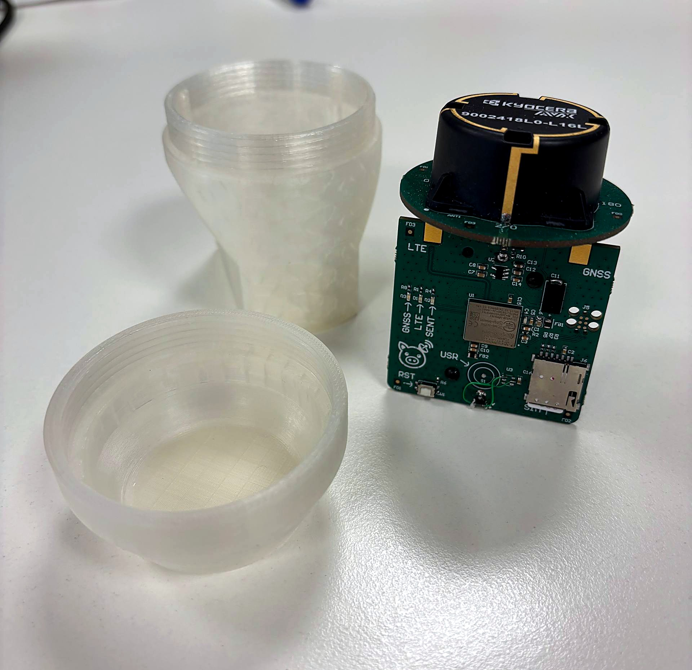
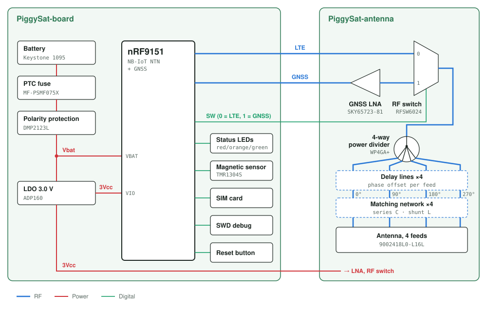
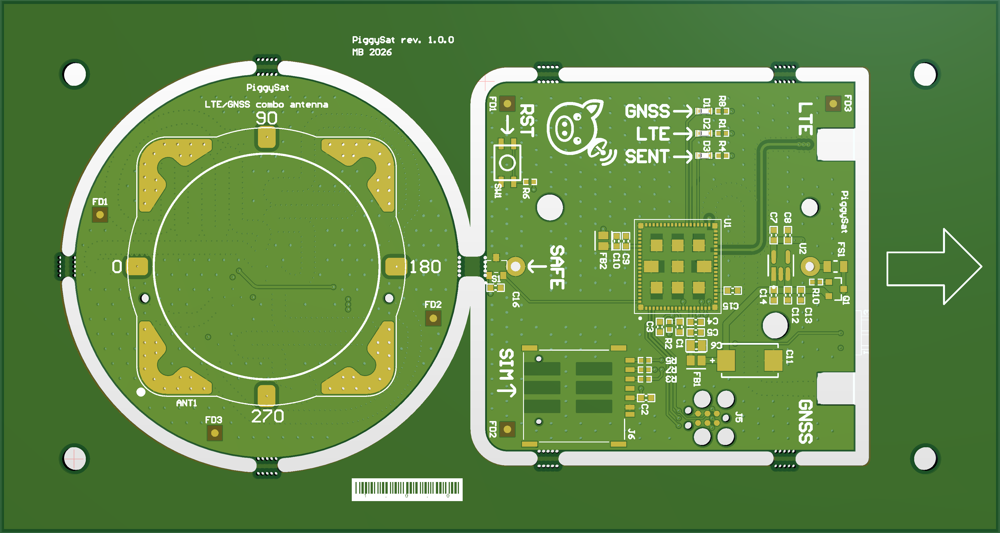
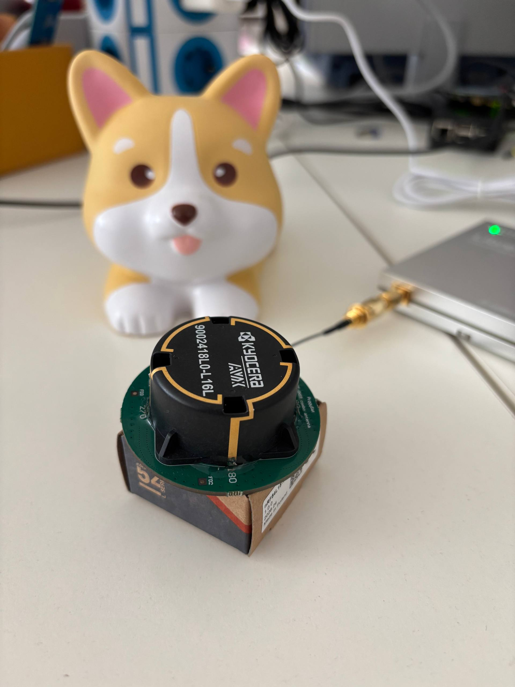
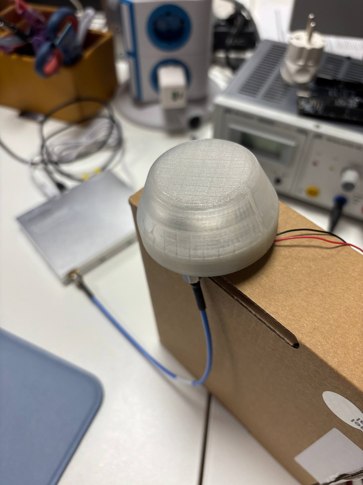
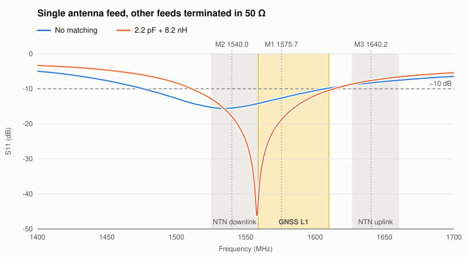
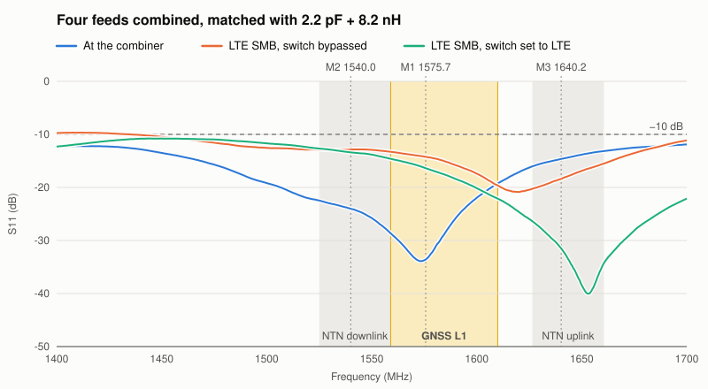
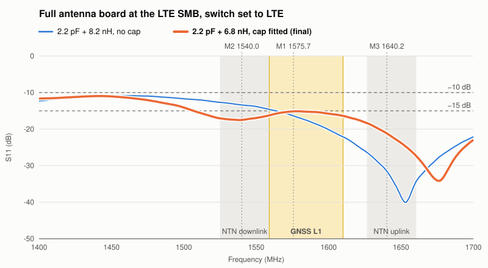

# PiggySat

PiggySat is an **open source satellite emergency communicator**: open hardware and open firmware that send short messages with a position directly over satellite, without terrestrial coverage. This repository holds the hardware (schematics, PCB, enclosure); the firmware is in [ing-barbiz/piggysat-fw](https://github.com/ing-barbiz/piggysat-fw).

To the best of our knowledge, PiggySat is the **world's first open source satellite communicator based on NB-IoT NTN**.

It is built on **NB-IoT NTN** (3GPP Release 17), the satellite extension of the cellular IoT standard, instead of a proprietary satellite network. The radio is a standard cellular IoT SiP (Nordic nRF9151) running NTN modem firmware, and connectivity comes from NTN operators with IoT-style data plans. Communicators based on proprietary systems such as Iridium need a dedicated satellite modem and per-message airtime, which makes them considerably more expensive to build and to run.

> **Not an emergency beacon.** PiggySat is not a certified COSPAS-SARSAT PLB/EPIRB and does not alert rescue services: messages go to a server you configure (ThingsBoard). Do not rely on it as your only means of calling for help.

**Project status:** the communicator firmware currently reports the GNSS position periodically and stops while a magnet is on the sensor. SOS messages, delivery confirmation to the user and battery management are not implemented yet.

The hardware is built as an Altium Designer multi-board assembly. It combines a compact nRF9151 radio and power board with a separate four-layer antenna board and includes the mechanical housing, reusable component libraries, and a PCB panel project.

The design is under active development. Review the schematics, component availability, RF constraints, and manufacturing data before building hardware.

  

## Purpose and architecture

- **Emergency communication** — designed to exchange essential data when terrestrial connectivity is unavailable.
- **Location** — the nRF9151 GNSS receiver determines the communicator's position.
- **Satellite data link** — the nRF9151 uses LTE NB-IoT NTN for transmitting and receiving data over satellite.
- **Integrated cellular IoT SiP** — a single nRF9151 handles both positioning and communication functions.
- **Simple user interface** — one touch button and three status LEDs provide direct control and visual feedback.
- **Rugged enclosure** — designed for an IP68 submersible housing suitable for emergency use in wet and exposed environments.
- **Multi-board construction** — the main electronics and antenna are implemented as separate PCBs and validated together in the Altium multi-board assembly.

## Block diagram

## Project layout

| Path | Description |
| --- | --- |
| `PiggySat.PrjMbd` | Top-level Altium multi-board project |
| `PiggySat.MbsDoc` | Multi-board schematic |
| `PiggySat.MbaDoc` | Multi-board assembly |
| `PiggySat.OutJob` | Multi-board output job |
| `PiggySat.stackup` | 1.6 mm four-layer fabrication stack-up |
| `PiggySat.RUL` | PCB design rules |
| `PiggySat-board/` | Main radio and power PCB project |
| `PiggySat-antenna/` | Antenna PCB project |
| `PiggySat-lib/` | Project schematic and PCB libraries |
| `PiggySat-panel/` | PCB panelization project |
| `Mechanical/` | IP68 housing design (Fusion 360 archive) and STEP models of the housing and PCB assembly |
| `Measurements/` | VNA S11 measurements of the antenna and matching network, with photos of the test setup |
| `Simulations/` | uSimmics simulations of the antenna matching network |
| `Pictures/` | README cover artwork, block diagram, and photos of the device |
| `Logo/` | Project artwork (PNG and SVG) |

## Hardware projects

### Main board

Open `PiggySat-board/PiggySat-board.PrjPcb` in Altium Designer. Its source documents are:

- `PiggySat-radio.SchDoc` — radio section
- `PiggySat-power.SchDoc` — power section
- `PiggySat-board.PcbDoc` — four-layer PCB layout
- `PiggySat-board.OutJob` — fabrication, assembly, and documentation outputs

The board uses the shared `PiggySat.stackup` and `PiggySat.RUL` in the repository root.

### Antenna board

Open `PiggySat-antenna/PiggySat-antenna.PrjPcb`. Its source documents are:

- `PiggySat-antenna.SchDoc` — antenna and feed network schematic
- `PiggySat-antenna.PcbDoc` — four-layer PCB layout
- `PiggySat-antenna.OutJob` — fabrication, assembly, and documentation outputs

The routed RF network includes phase/delay constraints for the `0DEG`, `90DEG`, `180DEG`, and `270DEG` nets. Preserve these constraints when changing the antenna feed network or stack-up.

### Component library

Open `PiggySat-lib/PiggySat.LibPkg` to edit or compile the project library. It contains:

- `PiggySat.SchLib` — schematic symbols
- `PiggySat.PcbLib` — footprints and component models

The compiled `PiggySat.IntLib` is not versioned. If Altium reports it missing while opening another project, compile the package, install or relink the resulting library, then confirm that every schematic component resolves to the intended symbol and footprint.

### Panel

Open `PiggySat-panel/PiggySat-panel.PrjPcb`. It contains `PiggySat-panel.PcbDoc` and `PiggySat-panel.OutJob`, which generates the production Gerber, NC drill, and pick-and-place data. Verify embedded-board links, tooling holes, rails, fiducials, breakaway features, and the fabricator's panel requirements before generating production data.

The panel holds one antenna board and one main board, rev. 1.0.0, held in the frame by breakaway tabs, with tooling holes and fiducials on the rails.

### Multi-board assembly

Open `PiggySat.PrjMbd` to inspect the relationship between the main board and antenna board through `PiggySat.MbsDoc` and `PiggySat.MbaDoc`. `PiggySat.OutJob` exports a STEP model of the full assembly for mechanical preview.

## Mechanical housing

The `Mechanical` directory contains:

- `PiggySat_housing.f3z` — Fusion 360 design archive of the housing
- `PiggySat_housing.step` — STEP model of the housing
- `PiggySat_pcb.step` — STEP model of the PCB assembly

The enclosure is designed to support an IP68 submersible implementation. The final ingress-protection rating depends on materials, seals, manufacturing tolerances, assembly, and validation testing; the design files alone do not constitute IP68 certification.

## Measurements and simulations

`Measurements/` contains S11 measurements of the antenna board, taken with a LibreVNA:

- `s11_*.s1p` — 50 Ω Touchstone S11 data, one file per configuration (see the table below)
- `OSL_1_1_40G-1_70G_501pt.cal` — open/short/load calibration, 1.40–1.70 GHz, 501 points
- `s11.setup` — LibreVNA setup: 1.40–1.70 GHz, 501 points, 1 kHz IF bandwidth, −10 dBm
- `pic*.jpg` — photos of the antenna board on the measurement setup

<table>
  <tr>
    <td align="center"> Antenna board without the cap</td>
    <td align="center"> Antenna board with the plastic cap fitted</td>
  </tr>
</table>

The measurements follow the antenna from a single bare feed to the complete board. Single-feed measurements were taken with the other three feeds terminated in 50 Ω. Each matching network is a 2.2 pF series capacitor followed by a shunt inductor.

| File | Configuration |
| --- | --- |
| `s11_uncomp.s1p` | One antenna feed, no matching network |
| `s11_comp_2p2_8n0.s1p` | One antenna feed, matched with 2.2 pF and 8.2 nH |
| `s11_combiner.s1p` | All four feeds matched with 2.2 pF and 8.2 nH, measured at the combiner, without the RF switch |
| `s11_comp_2p2_8n0_combiner_smb.s1p` | Full antenna board at the LTE SMB connector, RF switch bypassed to LTE |
| `s11_comp_2p2_8n0_combiner_switch_smb.s1p` | Full antenna board at the LTE SMB connector, RF switch powered and set to LTE |
| **`s11_full_cap.s1p`** | **Final configuration:** full antenna board matched with 2.2 pF and 6.8 nH, plastic cap fitted, at the LTE SMB connector, RF switch powered and set to LTE |
| `s11_line.s1p` | Check of one stripline terminated in 50 Ω (1.525–1.675 GHz sweep) |

The plots show the LibreVNA markers saved in `s11.setup`: M1 at 1575.7 MHz (GPS L1), M2 at 1540.0 MHz (NTN downlink), and M3 at 1640.2 MHz (NTN uplink). The yellow area is the GNSS L1 band (1559–1610 MHz, covering GPS L1, Galileo E1 and BeiDou B1), and the grey areas are the NTN downlink and uplink bands.

Measured S11 in dB, worst case within each band:

| File | GNSS L1 (1559–1610 MHz) | NTN downlink (1525–1559 MHz) | NTN uplink (1626.5–1660.5 MHz) |
| --- | ---: | ---: | ---: |
| `s11_uncomp.s1p` | −9.8 | −14.2 | −7.6 |
| `s11_comp_2p2_8n0.s1p` | −10.4 | −12.9 | −6.6 |
| `s11_combiner.s1p` | −19.2 | −22.5 | −13.2 |
| `s11_comp_2p2_8n0_combiner_smb.s1p` | −13.3 | −12.8 | −15.5 |
| `s11_comp_2p2_8n0_combiner_switch_smb.s1p` | −14.6 | −12.7 | −26.5 |
| **`s11_full_cap.s1p` (final)** | **−15.1** | **−16.2** | **−18.4** |
| `s11_line.s1p` | −19.8 | −21.7 | −18.3 |

The NTN ranges are those of 3GPP band 255. All board-level measurements were taken at the LTE SMB connector; the GNSS path through the LNA was not measured.

`Simulations/` contains the uSimmics models of the matching network (`piggysat.sch`) and their results (`piggysat.dat`). The measured `.s1p` files can be loaded into the simulations for comparison.

## Requirements

- Altium Designer 26
- Autodesk Fusion 360 for the housing
- uSimmics for the simulations
- A Gerber/NC viewer independent of Altium for fabrication-output verification
- Access to the component datasheets and the intended PCB manufacturer's current capabilities
## Recommended workflow

1. Compile `PiggySat-lib/PiggySat.LibPkg` and install or relink the resulting integrated library if required.
2. Open and compile the main-board and antenna projects independently, and review the compile messages.
3. Confirm the controlled-impedance stack-up with the selected fabricator before changing RF geometry.
4. Open the multi-board project and check clearances, connectors, orientation, and mechanical alignment.
5. Review the panel project against the fabricator's panelization rules.
6. Run the output jobs from a clean, tagged source revision.
7. Inspect Gerbers, drill files, BOM, and placement data with independent tools before release.

## Design status

Version `1.0.0` is the first release of the PiggySat hardware project. See [CHANGELOG.md](CHANGELOG.md) for its contents and known limitations.

RF, GNSS, satellite-link, power, environmental, ingress-protection, and regulatory validation remain the responsibility of the builder.

## Next steps and ideas

- **Display** — add a small display to show position, link state and received messages without a phone.
- **Bluetooth Low Energy link to a phone** — let a phone app write and read messages through PiggySat. The nRF9151 has no Bluetooth radio, so this needs an additional BLE chip.
- **Antenna matching** — optimize the matching network further across the GNSS L1 band and both NTN bands; see [Measurements and simulations](#measurements-and-simulations).
- **Radiation pattern** — measure the antenna's radiation pattern and gain, with and without the housing.
- **Idle current** — switch off the GNSS LNA and the RF switch between transmissions. Both are currently powered from `3Vcc` whenever the LDO is on, so their supply needs to be switchable from a GPIO.

## Version control

The repository contains only source material: Altium projects, documents, stack-up, rules and libraries, the housing design, measurements, simulations, and documentation. Files generated by the output jobs and by compiling the library are not versioned; regenerate them from the tagged revision you want to build. For traceable fabrication releases, attach the verified output archive to the Git tag or a GitHub Release.

Because Altium documents are mostly binary, keep commits small and explain schematic, layout, and library changes in commit messages. Avoid editing the same binary document concurrently on multiple branches.

## License

The original PiggySat hardware design files are licensed under the [CERN Open Hardware Licence Version 2 - Permissive](LICENSE), SPDX identifier `CERN-OHL-P-2.0`.

Copies, modifications, manufactured products, and redistributed versions must retain the applicable notices and credit the original work as:

> PiggySat — original hardware design by the PiggySat authors and contributors

See [NOTICE](NOTICE) for the attribution requirements. Modified versions must also identify that they were changed, with the date and a brief description. Third-party files remain governed by their respective licenses and notices.

## Authors

PiggySat was originally authored by **Marco Barbetta**. See [AUTHORS.md](AUTHORS.md) for authorship and contributor information.
